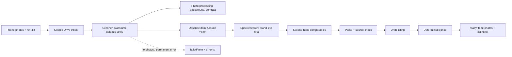

# vinted-listing

Turn a folder of product photos into a ready-to-post second-hand listing: photos on a clean neutral background, plus
copy-paste text for every field of the listing form (title, description, category, brand, size, condition, colours,
material, parcel size and a suggested price).

Drop a folder of phone photos into Google Drive, optionally with a short `hint.txt` typed from the item's tag, and a
few minutes later a finished package appears in `ready/`. You post it by hand from the phone.

> **Disclaimer.** This is an independent personal project, not affiliated with or endorsed by Vinted. It never
> connects to Vinted: there is no scraping, no automated posting and no account access. It only prepares the content
> you then post yourself.

## How it works



1. **Scanner.** A folder is handed over only after its file names and sizes stop changing (uploads arrive one file at
   a time). Without a `.txt` it waits a little longer for a late hint.
2. **Photo processing** (local, free): background removal with [rembg](https://github.com/danielgatis/rembg)
   (BiRefNet), optional colour-cast correction estimated from the background, gentle CLAHE contrast, composite onto a
   neutral grey, resize, strip EXIF (no GPS in published photos).
3. **Describe.** Claude reads the original photos: item type, colours, any visible logo or printed text, visible wear.
4. **Research.** Claude's server-side web search looks for the exact product, on the brand's official site first,
   and, when no asking price is given, for second-hand comparables. Skipped entirely when the hint is already complete.
5. **Parse and check sources.** Research notes become a schema-validated spec where every value carries its source
   (`hint`, `photo`, `web`, `inferred`). A web value whose URL was never actually retrieved is demoted and flagged.
6. **Draft listing.** Claude writes the title and description in the listing language (default `pt-PT`).
7. **Price.** Computed in code, not by the model: your asking price if given, else the median of comparables adjusted
   for condition, else a share of the tag's retail price, always flagged for review.
8. **Deliver.** The package lands in `ready/<item>/` with the originals; failures go to `failed/<item>/` with an
   `error.txt` naming the failing step.

## Design highlights

- **Grounded output.** Every researched fact keeps its source URL; invented URLs are caught by comparing against the
  URLs the web tools actually returned. Uncertain fields are listed in a `CHECK BEFORE POSTING` block.
- **The model sees originals, buyers see processed photos.** Image processing can never distort what the model
  describes.
- **Cost control.** Each pipeline stage has its own model (cheap Haiku for extraction, Sonnet for research and
  writing, Opus optional). Every API call is recorded in a local SQLite ledger with an estimated cost; a monthly budget
  and a daily item limit defer new items instead of overspending. Web search is capped per item.
- **Safe with a synced folder.** Packages are built in a temp folder, delivered as `.partial` then renamed; Drive file
  locks are retried with backoff; a folder whose move failed is never reprocessed in a loop; temporary API errors
  (rate limits, overload) retry up to three times before failing.
- **Cheap retries.** Processed photos are cached by a hash of the photos and processing settings, so a retry skips
  background removal.
- **Measurable.** A golden-set `eval` command scores listings against expected values and compares model profiles
  side by side, with cost per item.

More detail in [docs/design.md](docs/design.md).

## Example output

`ready/levis-501-w32/listing.txt` (illustrative):

```text
CHECK BEFORE POSTING:
- price

TITLE
Calças Levi's 501 Original W32 L32 azul clássico

DESCRIPTION
Calças de ganga Levi's 501 de corte direito, 100% algodão. Bom estado geral, com ligeiro desgaste natural nos joelhos.

CATEGORY
Homem > Roupa > Calças > Jeans

BRAND
Levi's

SIZE
W32 L32

CONDITION
Very good

COLOURS
blue

MATERIAL
100% cotton

PARCEL SIZE
Small

PRICE (EUR)
24
median of 3 comparables (20, 24, 28) × 1 for Very good = 24 → 24

SOURCES
https://www.levi.com/...
```

## Quick start

Requires Python 3.12+ and [uv](https://docs.astral.sh/uv/). Developed and used on Windows with Google Drive for
desktop; the code itself is cross-platform.

```bash
git clone <this repo>
cd vinted-listing
uv venv --python 3.12 .venv
uv pip install --python .venv -e ".[dev]"
.venv/Scripts/python -m pytest        # Windows; use .venv/bin/python on Linux/macOS
```

### Configure

Settings live outside the repo in `<state_dir>/.env`, where `state_dir` is `%LOCALAPPDATA%\vinted-listing` on Windows,
`~/.local/share/vinted-listing` elsewhere, or `$VINTED_LISTING_HOME` if set. Start from `.env.example`:

```bash
ANTHROPIC_API_KEY=sk-ant-...
DRIVE_ROOT=/path/to/Google Drive/Vinted
```

Get an API key at [console.anthropic.com](https://console.anthropic.com); setting a monthly spend limit there is a good
idea.

### Use

```bash
python -m vinted_listing run "/path/to/item-folder"   # one folder, left untouched; output in <state_dir>/runs/
python -m vinted_listing watch                        # watch DRIVE_ROOT/inbox continuously
python -m vinted_listing costs                        # month-to-date cost and remaining budget
```

Drive layout used by `watch`:

```
<DRIVE_ROOT>/
  status.txt       waiting / deferred / stuck items, budget, last results (readable from the phone)
  inbox/<item>/    photos (first = cover) + optional hint.txt
  ready/<item>/    01.jpg..NN.jpg, listing.txt, listing.json, originals/
  failed/<item>/   originals + error.txt
```

### hint.txt

Optional `key: value` lines, typically typed from the item's tag on the phone (blank values are ignored):

```text
brand: Levi's
model: 501
size: W32 L32
composition: 100% cotton
colour: indigo
condition: Very good
price: 25
retail_price: 99.95
notes: small stain on left sleeve
```

`condition` is one of `New with tags`, `New without tags`, `Very good`, `Good`, `Satisfactory`. `price` is used as is;
without it a price is suggested. `research: no` skips web research; it is also skipped automatically when `brand`,
`model` and `price` are all given.

## Configuration

| Setting | Default | Meaning |
|---|---|---|
| `MODEL_PROFILE` | `mixed` | `mixed`: Haiku 5.5 describe/parse, Sonnet 5.5 research/listing. `opus`: Opus 5.5 everywhere |
| `MODEL_DESCRIBE`, `MODEL_RESEARCH`, `MODEL_PARSE`, `MODEL_LISTING` | from profile | Override one stage |
| `MONTHLY_BUDGET_USD` / `DAILY_ITEM_LIMIT` | `20` / `30` | New items are deferred once reached |
| `MAX_SEARCHES_PER_ITEM` / `MAX_FETCHES_PER_ITEM` | `6` / `4` | Web tool caps per item |
| `LISTING_LANGUAGE` | `pt-PT` | Language of title and description |
| `BACKGROUND_COLOR` | `#ECECEC` | Replacement background |
| `WHITE_BALANCE` | `true` | Colour-cast correction from the background; needs a **neutral** background |
| `REMBG_MODEL` | `birefnet-general` | `u2net` is lighter on CPU |
| `TITLE_MAX_CHARS` | unset | Cut titles longer than this and flag them |
| `QUIET_SECONDS` / `HINT_GRACE_SECONDS` | `120` / `1800` | Upload settling time / wait for a late hint |

## Costs

Estimated at list prices; the `costs` command reports what was actually used.

| Profile | Per item (with comparables) | Price in hint | Research skipped |
|---|---|---|---|
| `mixed` | ~$0.27 | ~$0.18 | ~$0.05 |
| `opus` | ~$0.70 | ~$0.50 | ~$0.15 |

## Running in the background (Windows)

```bat
schtasks /Create /SC ONLOGON /TN vinted-listing /TR "\"C:\path\to\vinted-listing\.venv\Scripts\pythonw.exe\" -m vinted_listing watch"
schtasks /Run /TN vinted-listing
```

The watcher waits for the Drive folder to be mounted, allows a single instance, and logs to
`<state_dir>/logs/vinted-listing.log`. `schtasks /End` stops it and `schtasks /Delete /TN vinted-listing /F` removes it.

## Development

```bash
python -m pytest                       # offline suite (fakes for the API and background removal)
python -m pytest -m live               # real API + model download; needs ANTHROPIC_API_KEY and LIVE_PHOTO
python -m vinted_listing eval <golden_dir> --profile opus
python -m vinted_listing eval-compare <run_a>/report.csv <run_b>/report.csv
```

A golden set is a folder of item subfolders, each with photos, an optional `hint.txt` and an `expected.json` such as
`{"brand": "Levi's", "size": "W32 L32", "category": ["jeans"], "colours": ["blue"], "price_range": [15, 30]}`.

## Limitations and roadmap

- Colour correction assumes a neutral background; on coloured surfaces set `WHITE_BALANCE=false`.
- The listing schema is clothing-oriented; toy-specific fields (age range, completeness) are not modelled yet.
- Items with no tag and no visible branding rely on Claude's description; a reverse image match (Google Cloud Vision
  Web Detection) is planned if evaluation shows it is needed.
- Planned: container image and optional OpenTelemetry tracing of API calls.
- Costs are estimates at public list prices.

## License

[MIT](LICENSE)
